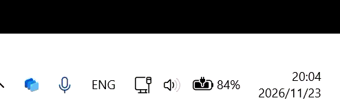

# 任务栏自适应变色 · Adaptive Tray Contrast

把 Windows 11 的任务栏设成透明之后，底下有时是亮色窗口，有时是深色壁纸，原本固定的白字或黑图标经常会糊在背景里看不清。这个 Windhawk 模组就是为了解决这个日常小问题做的。

它**不是**让整条任务栏跟着系统浅色或深色主题一起切换，而是**根据每个受支持元素所在位置的实际背景画面，各自单独判色**。因此同一条任务栏可以一边显示黑色、一边显示白色。最直观的例子是，把一个亮色窗口慢慢拖过右下角的日期，当深浅分界线划过时，同一行日期里的数字会按各自背后的明暗分别变黑或变白。

除了系统托盘里受支持的单色图标和文字外，模组也会识别部分自带深、浅两套图标的 MSIX 应用，按各自按钮背后画面的明暗自动切换对应版本的图标。

- 适用环境：Windows 11 x64（需配合 Windhawk 使用）
- 当前首发版本：`0.3.13` 测试版（经实测选定）

## 实机演示

**应用图标** · 拖动窗口，观察 ChatGPT 和 Microsoft Store 图标随各自按钮背后的明暗切换。

**右侧托盘、时间和日期** · 当窗口边缘扫过日期，同一行的数字会分别显示为黑色或白色。

## Summary (English)

**Adaptive Tray Contrast** is a Windhawk mod for Windows 11 (x64) built for transparent taskbars. Instead of switching the entire taskbar together with the system theme, it samples the live background behind each supported element independently and chooses black or white per element—even per character on the clock and date, so digits in the same date line can turn black or white individually as a window boundary moves behind them. It also switches between light and dark icon variants for supported MSIX apps that ship dual icon sets. Initial release: `0.3.13` beta.

## 安装与更新

- **首次安装**：在本仓库中打开 `adaptive-tray-contrast.wh.cpp`，复制完整源码；打开 Windhawk 新建一个本地模组，将默认代码全选替换为复制的源码，点击 **编译 Mod** 即可生效。
- **已有旧版更新**：在 Windhawk 中直接编辑原有的 `adaptive-tray-contrast` 模组，全选替换为最新源码后重新点击 **编译 Mod**。

## 已知问题与反馈

- 当图标或文字刚好落在深浅背景的交界处时，有时会出现短暂闪烁。

如果你在使用中遇到显示异常、图标切换问题或其他 Bug，欢迎在仓库的 **Issues** 里反馈，提交时请尽量附上你的 **Windows 版本号**（可按 `Win + R` 输入 `winver` 查看）以及**复现步骤**。

## 署名与许可证

本项目由 **StillDialing** 提出需求、实机测试并挑选首发版本，模组代码在 AI 协助下完成。

源码采用 **GPL-3.0-only** 许可证发布，并保留源码中原有第三方参考实现的署名与来源说明。
