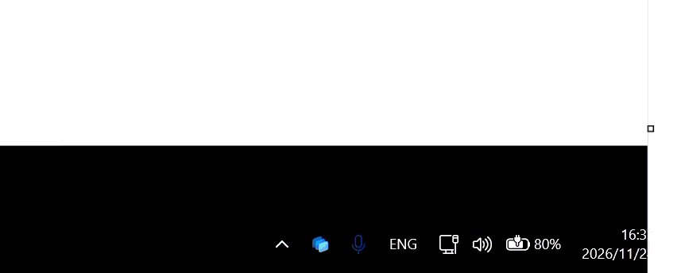

# Adaptive Tray Contrast

On a transparent Windows 11 taskbar, a light window can sit behind half the date while the other half is over dark wallpaper. This Windhawk mod chooses black or white for each clock and date character according to the background behind it.

Supported monochrome tray icons and the Chinese/English input indicator adapt independently. Start, Search, Task View, Widgets and app buttons can switch button themes. For packaged apps that provide both light and dark icon variants, the mod uses the variant that suits each button's background. Colored tray icons and the colored part of the battery keep their original colors. A packaged app's themed icon can cover its own dynamic artwork.

In 0.3.16, clicking the Chinese/English input indicator hides the previous tinted glyph while the new one is captured. When the native glyph already has the desired color, the mod displays it directly.

## 中文说明

在 Windows 11 的透明任务栏上，如果浅色窗口的边缘刚好穿过日期，同一行里，压在浅色窗口上的数字可以变黑，留在深色壁纸上的数字可以保持白色。时间和日期分别逐字符判断。

模组也会分别调整受支持的单色托盘图标和中英文输入法指示器，切换开始、搜索、任务视图、小组件及应用按钮的深浅主题。打包应用如果自带深浅两套图标，模组会按每个按钮背后的画面选用对应图标。彩色托盘图标和电池的彩色部分保留原色；应用自带的动态图案可能被深浅版图标覆盖。

从 0.3.16 起，点击“中／英”时会先撤下旧字的着色层，再用新字着色，减少切换瞬间的重影。如果系统原字已经是需要的颜色，就直接显示原字。

## Demos · 实机演示

### App icons · 应用图标

**Drag a window · 缓慢拖动窗口**  
Watch each supported app icon as the window edge passes behind its button.  
窗口边缘扫过不同按钮时，各应用图标分别切换深浅版本。

**Switch between full-screen apps · 切换全屏应用**  
Compare the app icons as you switch apps and reveal the taskbar.  
切换全屏应用，观察任务栏显示时应用图标的变化。

### System tray, clock and date · 右侧托盘、时间和日期

**Drag a window · 缓慢拖动窗口**  
Follow the window edge across the tray icons and individual clock and date characters.  
留意窗口边缘经过右侧托盘和日期时，哪些图标、哪些数字先变色。

**Switch between full-screen apps · 切换全屏应用**  
Compare the right side of the taskbar against the different backgrounds.  
切换全屏应用后，对比不同背景下右侧托盘、时间和日期的颜色。

## Settings · 设置

The default sampling interval is 80 ms (adjustable from 40 to 2000 ms). A longer interval samples less often and responds more slowly. Sharp background boundaries can cause brief flicker.

默认每 80 毫秒采样一次，可在设置中调整为 40 至 2000 毫秒。间隔越长，采样越少，响应也越慢。图标恰好位于深浅交界处时可能短暂闪烁。

## Installation and updates · 安装与更新

**Windows 11 and Windhawk · Windows 11，需安装 Windhawk**  
Version `0.3.16` compiles for both x64 and ARM64. The input indicator fix was tested on x64. ARM64 runtime behavior still needs verification on hardware.  
当前版本为 `0.3.16`，支持 x64 和 ARM64 编译。中英文切换修复已在 x64 电脑实测，ARM64 设备上的实际表现仍待验证。

1. Open the [source file](adaptive-tray-contrast.wh.cpp) and copy the entire file. 打开[模组源码](adaptive-tray-contrast.wh.cpp)，复制完整内容。
2. In Windhawk, create a local mod for the first installation. To update, open the existing mod and choose **Edit**. 首次安装时新建本地模组；更新时打开已有模组，点**编辑**。
3. Replace the editor contents and choose **Compile Mod**. 全选替换编辑器里的代码，点**编译 Mod**。

## Feedback · 反馈

Please include your Windows build (run `winver`), the affected icon and the steps to reproduce the issue. 反馈时请注明 Windows 版本号（运行 `winver` 可查看）、受影响的图标及复现步骤。[Issues](../../issues)

## Credits and license · 署名与许可证

**StillDialing** proposed the mod and tested it on Windows. The code was written with AI assistance. The source retains the credits for third-party reference implementations.  
**StillDialing** 提出需求并进行 Windows 实机测试。模组代码在 AI 协助下完成，源码中保留了第三方参考实现的署名。[GPL-3.0-only](LICENSE)
